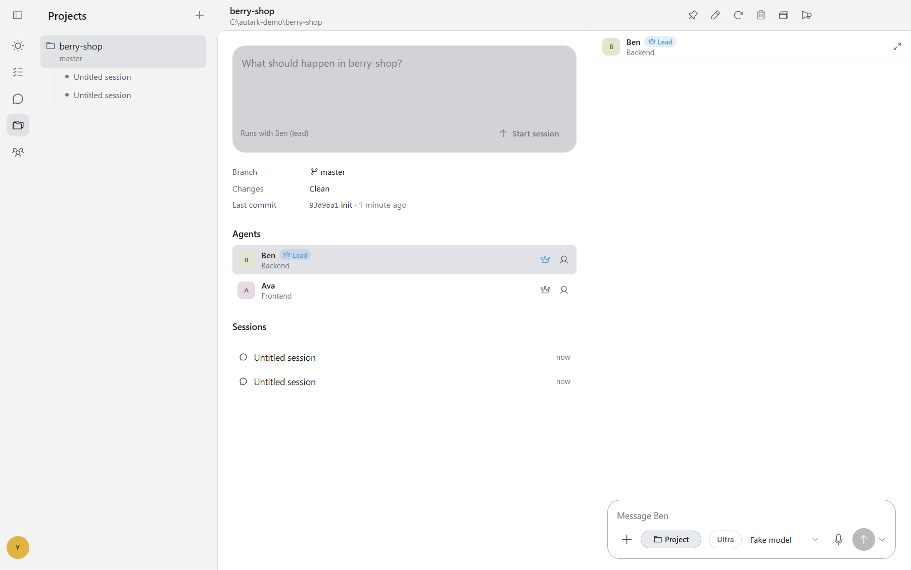
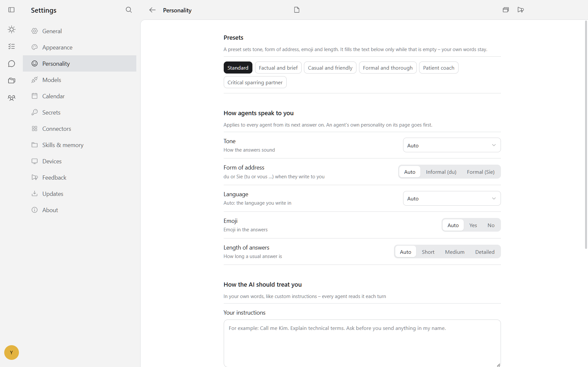
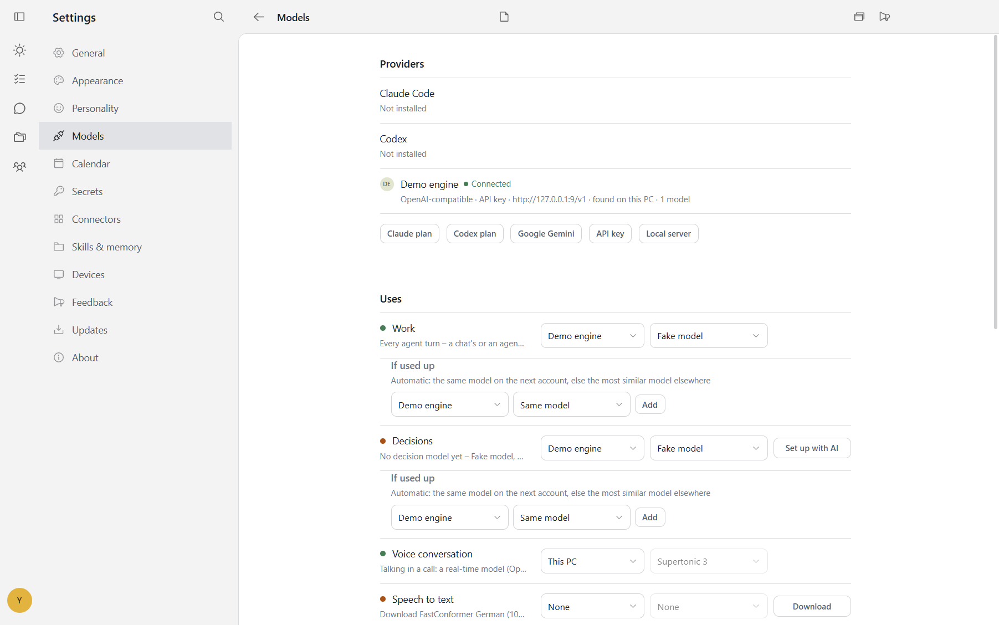
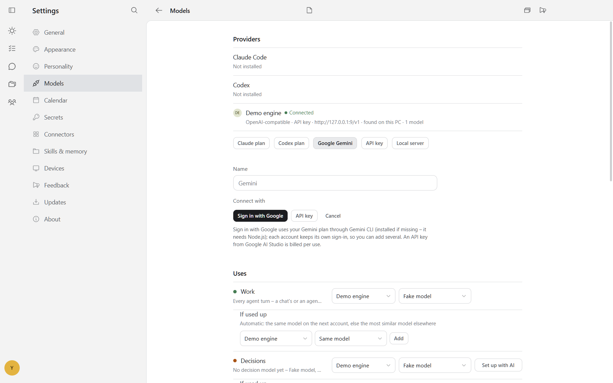

# Autark-Plus

**An independent, extended build of the Autark desktop app: an AI team with a personal manager, projects, account fallback and a customizable interface.**

Desktop (Windows, Mac, Linux) · Android and iPhone web app · headless Linux server mode · Apache-2.0

[](docs/images/project-light.png)

**[Download](#download)** · **[Explore the gallery](#screenshot-gallery)** · **[Test results](docs/TEST_RESULTS.md)** · **[Open points](#open-points)** · **[All documentation](docs/README.md)**

> **Autark-Plus is a standalone project by [Noriel (desquerteur)](https://github.com/desquerteur), not the original and not an official Autark release.**
> It is built on **Autark / OpenAutark by Teydra Lab** ([teydra/OpenAutark](https://github.com/teydra/OpenAutark), created by Stanislaus Hees,
> [openautark.com](https://openautark.com)), licensed under the Apache License 2.0. All credit for the foundation goes to the original authors:
> the agent runtime, the team model, memory, tasks, the apps and the website come from there. Everything described under
> [what Autark-Plus adds](#what-autark-plus-adds) was built on top by this project. The Apache notices, the copyright line and the
> licence texts are kept (see [License and credit](#license-and-credit)). The name "Autark" and its logo stay with their owners
> (Apache-2.0 section 6): Autark-Plus is an independent fork, not endorsed by Teydra.
> Want the original? Use [teydra/OpenAutark](https://github.com/teydra/OpenAutark) and its [downloads](https://openautark.com/download/).

## Contents

- [Introduction](#introduction)
- [What Autark-Plus adds](#what-autark-plus-adds)
- [Status of the features](#status-of-the-features)
- [Screenshot gallery](#screenshot-gallery)
- [Where things are](#where-things-are)
- [First launch and guided tour](#first-launch-and-guided-tour)
- [Try a task with a checkable answer](#try-a-task-with-a-checkable-answer)
- [Download](#download) · [Installing](#installing) · [Updates](#updates)
- Own pages: [Accounts, fallback and Gemini](docs/ACCOUNTS_AND_GEMINI.md) · [Linux headless](docs/LINUX_HEADLESS.md) · [Project isolation](docs/PROJECT_ISOLATION.md) · [Updates from this repository](docs/UPDATES.md)
- [Settings and privacy](#settings-and-privacy)
- [Tests and observed results](#tests-and-observed-results)
- [Open points](#open-points)
- [Building from source](#building-from-source) · [Repository layout](#repository-layout) · [The public library](#the-public-library)
- [Contributing and security](#contributing-and-security)
- [License and credit](#license-and-credit)

## Introduction

**Autark gives you an ongoing AI team instead of one chat window.** You talk to a personal manager; colleagues with roles, memory and
tasks do the work, and you inspect what comes back. Autark-Plus keeps that idea and adds the things that were missing in daily use:
working in several code projects at once, surviving a used-up AI plan, and an interface you can shape.

- **Projects:** a Projects tab with your folders, their branch and changed files, their agents and sessions. Type what should happen and an agent works in exactly that folder.
- **Account fallback:** with several plans or keys, a used-up account no longer stops the work; the next one stands in and the chat says so. Google Gemini accounts work side by side.
- **Access you choose:** read-only, ask first, automatic inside the project folder, or full access, per agent and per chat.
- **Your own look:** themes, drag-and-drop layout, chat tabs docked right, left, top, bottom or floating.
- **Calm multi-agent view, prompt queue, Stop button, dictate-and-send, a call screen that looks like a call.**
- **A guided start:** a four-step setup and a spotlight tour through the whole app.
- **Runs without a window on Linux** and updates itself from this repository.

Bring your own supported model access (Claude Code, Codex, Gemini, API keys or a local model server). Cloud models receive the prompts
sent to them; running the app on your PC does not make cloud inference local. Agents act with the access you give them: this is not a
sandbox, and not every action waits for approval unless you choose a mode that asks (see [Settings and privacy](#settings-and-privacy)).

Downloads and repository source are separate artifacts. Read each release's notes and checksums; a version label alone does not prove that a
binary was built from the source tag you are reading.

## What Autark-Plus adds

Everything in this table is on top of the original. Where the original already had a thing, it is not listed.

| Area | What it does | Details |
| --- | --- | --- |
| **Projects tab** | Folders as projects with branch, changes, last commit, sessions and a "What should happen in ...?" field; project lead (crown); side chat with an agent; project chip in the chat header; command palette entries | [gallery](#screenshot-gallery), [isolation](docs/PROJECT_ISOLATION.md) |
| **Agent from a folder** | Pick a folder, drag it in, or use the Explorer right-click; the agent reads `CLAUDE.md` / `AGENTS.md` and the project's skills | - |
| **Agent directory** | Every agent in one place, grouped by project, team or status | [gallery](#screenshot-gallery) |
| **Accounts and fallback** | Several accounts per provider, per-chat and per-agent account choice, a fallback order for "if used up", effort slider | [Accounts](docs/ACCOUNTS_AND_GEMINI.md) |
| **Google Gemini** | Sign in with Google (Gemini CLI, installed for you) or an API key; several accounts side by side; quota-aware | [Accounts](docs/ACCOUNTS_AND_GEMINI.md) |
| **Access modes** | Read only, ask first, automatic in the project folder, full access; rules and approval requests | - |
| **Personality** | Tone, address, language, emoji, length, free text; global and per agent; presets | [gallery](#screenshot-gallery) |
| **Appearance** | Own themes with live preview, layout by drag and drop, chat tabs dockable on every side, reset to default | [gallery](#screenshot-gallery) |
| **Connectors** | GitHub, Google, Notion, Slack, Discord, your own MCP server (stdio or HTTP), paste a `mcpServers` JSON | [gallery](#screenshot-gallery) |
| **Skills from links** | Install skills from a GitHub URL, a `SKILL.md` or a ZIP, with a preview and later updates | - |
| **Composer** | Send turns into Stop while an agent works; per-chat prompt queue; dictate and send | - |
| **Calls** | A call screen that looks like a call (status, duration, mute, hang-up, call card with transcript) | - |
| **Onboarding** | Four-step setup and a 24-step spotlight tour | [First launch](#first-launch-and-guided-tour) |
| **Agents write as agents** | Chat tools are always available; `wf` messages carry the agent's name, not yours; restarts are capped | - |
| **Feedback** | Sent, confirmed with a number, failures visible and logged (needs a receiver, see [open points](#open-points)) | - |
| **Updates from this repo** | Source, channel and automatic check in Settings; release workflow that builds and publishes | [Updates](docs/UPDATES.md) |
| **Headless Linux** | Run without a window as a service; pair a browser or phone with a link and code | [Linux headless](docs/LINUX_HEADLESS.md) |
| **Project isolation** | An agent in a project reaches only its project's agents and you | [Project isolation](docs/PROJECT_ISOLATION.md) |

## Status of the features

"Unit-tested" means the matching automated tests pass in the 0.3.8 test run ([report](docs/TEST_RESULTS.md)). It does not mean the
feature was tried by hand on every system. Window tests (real Electron windows) have 22 open failures; they are listed in the report.

| Feature | Status in 0.3.8 | Evidence | Still open |
| --- | --- | --- | --- |
| Projects tab, project page, project lead | Works in the demo profile (see gallery); unit-tested; a live smoke test opened a project list with branches and sessions | [9ab0945](https://github.com/desquerteur/Autark-Plus/commit/9ab0945), [64eaaa3](https://github.com/desquerteur/Autark-Plus/commit/64eaaa3) | Not yet used for a long real coding session |
| Agent from a folder | Implemented, unit-tested | [82d540f](https://github.com/desquerteur/Autark-Plus/commit/82d540f) | - |
| Agent directory | Works in the demo profile; unit-tested | [f310ffc](https://github.com/desquerteur/Autark-Plus/commit/f310ffc) | - |
| Account fallback, account choice, effort slider | Unit-tested (65 tests); live Claude and Codex accounts show *Connected* | [c2419fc](https://github.com/desquerteur/Autark-Plus/commit/c2419fc), [6635a01](https://github.com/desquerteur/Autark-Plus/commit/6635a01) | A real fallback switch with two real plans was not triggered on purpose |
| Google Gemini accounts | Unit-tested (40 tests); the add panel opens | [509b0e6](https://github.com/desquerteur/Autark-Plus/commit/509b0e6) | **Live sign-in hung at "Installing Gemini CLI"** in the smoke test; the API-key path was not checked; see [open points](#open-points) |
| Access modes and rules | Implemented, unit-tested | [646cc7e](https://github.com/desquerteur/Autark-Plus/commit/646cc7e) | - |
| Personality (global, per agent) | Works in the demo profile; unit-tested | [f4301fe](https://github.com/desquerteur/Autark-Plus/commit/f4301fe) | - |
| Appearance, layout, chat tabs dock | Works in the demo profile; unit-tested | [abee4cb](https://github.com/desquerteur/Autark-Plus/commit/abee4cb), [af54b20](https://github.com/desquerteur/Autark-Plus/commit/af54b20) | Window test `chat-dock` fails here (timeout, cause unknown) |
| Connectors, own MCP server, JSON import | Works in the demo profile; unit-tested | [087fa6a](https://github.com/desquerteur/Autark-Plus/commit/087fa6a) | The Fusion connector logs a transport error at every start when Fusion 360 is not running |
| Skills from links | Implemented, unit-tested | [bb66882](https://github.com/desquerteur/Autark-Plus/commit/bb66882) | Window test `skill-links` partly stale |
| Stop button, prompt queue, dictate and send | Implemented, unit-tested | [5cc53ca](https://github.com/desquerteur/Autark-Plus/commit/5cc53ca), [f149012](https://github.com/desquerteur/Autark-Plus/commit/f149012) | - |
| Call screen | Implemented | [7a4f141](https://github.com/desquerteur/Autark-Plus/commit/7a4f141) | Not tested with a real voice model in the 0.3.8 run |
| Setup and spotlight tour | Works in the demo profile (24 steps) | [bdd8353](https://github.com/desquerteur/Autark-Plus/commit/bdd8353) | Window test `spotlight-tour` not confirmed green |
| Agents write as agents, restart cap | Implemented, unit-tested | [7c6be7c](https://github.com/desquerteur/Autark-Plus/commit/7c6be7c) | - |
| Feedback | Sending confirmed with a number; unit-tested after a fix | [6b2090e](https://github.com/desquerteur/Autark-Plus/commit/6b2090e) | No receiver is configured in this fork; window tests `feedback-button` / `feedback-inbox` fail here |
| Updates from this repository | Settings page works; "Check now" ran | [3d00dd2](https://github.com/desquerteur/Autark-Plus/commit/3d00dd2), [2b1858b](https://github.com/desquerteur/Autark-Plus/commit/2b1858b) | The first release from this repository has to be published to prove the whole chain |
| Headless Linux | Start, pairing, lock against a second start and the script's syntax tested on Windows (11 tests) | [8b6696b](https://github.com/desquerteur/Autark-Plus/commit/8b6696b) | **Not run on a real Linux host** (download, systemd, libraries, update, uninstall) |
| Project isolation | Unit-tested (22 tests) | [27f2819](https://github.com/desquerteur/Autark-Plus/commit/27f2819) | Not exercised with live agents |
| Windows installer | Built and verified for 0.3.7 (9/9 installer tests) | [report](docs/TEST_RESULTS.md) | Not re-run for 0.3.8 |
| Mac | From 0.4.0 cross-built on Linux (`scripts/release/build-mac.sh`), ad-hoc signed; bundle, CPU and signature checked | - | **Not yet started on a real Mac** |
| Android | Signed APK built on the release PC; installs and starts on the Android emulator | - | - |

## Screenshot gallery

All captures come from a **clean demo profile** (empty data folder, built-in demo engine, no accounts, no personal data, a demo project
named *berry-shop*) of the 0.3.8 source on 19 November 2026. The demo engine only echoes text, so chat answers are not shown. Click an
image for the full size. How they were made: [docs/SCREENSHOTS.md](docs/SCREENSHOTS.md).

| Projects | Agent directory |
| --- | --- |
| [](docs/images/project-dark.png) | [](docs/images/team-light.png) |
| Branch, changes, agents with the project lead and sessions, and a side chat. | Every agent in one place, grouped by project, team or status. |

| Appearance and layout | Personality |
| --- | --- |
| [](docs/images/settings-appearance-dark.png) | [](docs/images/settings-personality-light.png) |
| Themes, drag-and-drop layout, chat tabs dock and width. | Tone, address, language and your own instructions. |

| Models, accounts and fallback | Google Gemini |
| --- | --- |
| [](docs/images/settings-models-light.png) | [](docs/images/gemini-dialog.png) |
| Providers, which model does which job, and "If used up". | Sign in with Google or use an API key. |

| Connectors | Updates |
| --- | --- |
| [](docs/images/settings-apps-light.png) | [](docs/images/settings-updates-dark.png) |
| GitHub, Google, Notion, Slack, Discord, your own MCP server or pasted JSON. | Source, channel and automatic checks. |

| Setup | Spotlight tour |
| --- | --- |
| [](docs/images/first-run.png) | [](docs/images/tour-1.png) |
| Four steps; each can be skipped. | 24 steps; Settings has "Show the tour again". |

## Where things are

The left rail switches the main areas; the sidebar next to it lists what is in the area.

| Area | What you do there |
| --- | --- |
| **My day** | Calendar, what needs you, timeline |
| **Work** | What is running, reports, people and agents |
| **Chats** | Talk to your manager and your colleagues; the chat's tabs (browser, files, notes, media ...) dock where you want them |
| **Projects** | Folders with their agents and sessions; start a session by typing what should happen |
| **Team** | Every agent in one place; hire, open, or jump to its project |
| **Settings** | General, Appearance, Personality, Models, Calendar, Secrets, Connectors, Skills and memory, Devices, Feedback, Updates, About |

## First launch and guided tour

A new profile starts with a four-step setup: *About you* (language and name), *Connect an AI* (a plan, an API key or a local server),
*Connect your tools* and *Your first agent*. Every step explains itself in a line and can be skipped. A spotlight tour then walks through
the app in 24 steps; leave it any time. Both can be started again in **Settings → General → Getting started**
("Show the tour again", "Run setup again").

## Try a task with a checkable answer

Install Autark, connect your supported model account, and use a test workspace without sensitive files or accounts.
Then give your manager this task. The offers are fictional; no web research or sign-up is needed.

```text
Help me choose a booking tool for a four-person team. We need CSV export and can spend at most EUR 45/month.
Offline use would be nice, but is not required.

Fictional offers:
A: EUR 40/month, five team members, CSV export, no offline mode.
B: EUR 25/month, three team members, CSV export, no offline mode.
C: EUR 30/month, five team members, offline mode, no CSV export.

Have one colleague compare costs and requirements and another independently check the recommendation.
Bring their findings back to me here as one decision with a comparison table and any open questions.
Use only these facts. Do not browse, contact anyone, sign up, or buy anything.
```

**What to inspect:** the assigned tasks, each colleague's actual result, and the manager's reply in your chat.
Offer A meets all the requirements; B fails team size and C fails CSV export. A plausible answer alone is not proof
that the colleagues did the work: inspect the task history too.

For a second check, change the budget to EUR 32/month. Now none of the offers meets every requirement.
Does the team explain the conflict, or quietly drop a requirement? There is no promised runtime or parallelism here.
[Report what happened](https://github.com/desquerteur/Autark-Plus/issues/new), including failures.


## About the original Autark: coverage and interviews

- [The Register, 10 November 2026](https://www.theregister.com/ai-and-ml/2026/11/10/14-year-old-creates-tool-for-ai-agents-to-band-together-like-a-team/5308841):
  reporting on the project and its founder, including criticism of the security boundaries.
- [AI Business, 9 November 2026](https://aibusiness.vc/startups/openautark-teydra-lab-ai-agent-team-on-your-own-computer):
  a company-submitted written Partner Story, not an independent product test.

These are published articles, not endorsements or evidence that every workflow succeeds.

## Download

The links below always lead to the newest version.

| Device | File | Download |
|---|---|---|
| Windows 10/11 (x64) | `autark-windows-x64.exe` | [Download for Windows](https://github.com/desquerteur/Autark-Plus/releases/latest/download/autark-windows-x64.exe) |
| Mac (Apple silicon M1–M4 / Intel) | `autark-mac-arm64.zip`, `autark-mac-x64.zip` | [Apple silicon](https://github.com/desquerteur/Autark-Plus/releases/latest/download/autark-mac-arm64.zip) · [Intel](https://github.com/desquerteur/Autark-Plus/releases/latest/download/autark-mac-x64.zip) |
| Linux desktop (x64) | `autark-linux-x64.AppImage` | [Download AppImage](https://github.com/desquerteur/Autark-Plus/releases/latest/download/autark-linux-x64.AppImage) |
| Debian/Ubuntu desktop (x64 / arm64) | `autark-linux-amd64.deb`, `autark-linux-arm64.deb` | [x64](https://github.com/desquerteur/Autark-Plus/releases/latest/download/autark-linux-amd64.deb) · [arm64](https://github.com/desquerteur/Autark-Plus/releases/latest/download/autark-linux-arm64.deb) |
| Linux server (x64 / arm64) | `autark-linux-x64.tar.gz`, `autark-linux-arm64.tar.gz` | [x64](https://github.com/desquerteur/Autark-Plus/releases/latest/download/autark-linux-x64.tar.gz) · [arm64](https://github.com/desquerteur/Autark-Plus/releases/latest/download/autark-linux-arm64.tar.gz) – installed by `scripts/install-headless.sh` |
| Android phone | `autark-android.apk` | [Download for Android](https://github.com/desquerteur/Autark-Plus/releases/latest/download/autark-android.apk) |
| iPhone | – | A web app from your own PC (see below) |

- [Checksums (SHA-256)](https://github.com/desquerteur/Autark-Plus/releases/latest/download/SHA256SUMS.txt) for every file of
  the release, and [release.json](https://github.com/desquerteur/Autark-Plus/releases/latest/download/release.json) with what
  was checked for it and what was not.
- How releases are built and the Android APK is signed: [docs/RELEASING.md](docs/RELEASING.md).
- [All releases and their notes](https://github.com/desquerteur/Autark-Plus/releases).

Check a download on Windows with `Get-FileHash .\autark-windows-x64.exe` (PowerShell), on Mac and Linux with
`shasum -a 256 <file>`, and compare it with the line in `SHA256SUMS.txt`.

## Installing

### Linux server (Debian / Ubuntu)

Install the latest release as a system service, without a desktop or display:

```bash
curl -fsSL https://raw.githubusercontent.com/desquerteur/Autark-Plus/main/scripts/install-headless.sh | sudo bash
```

The installer verifies the release checksum, starts Autark as its own unprivileged user, and prints a pairing link/code.
The script runs as root: review it first if required by your server policy. See [server setup and removal](docs/headless-linux.md).

### Desktop and Android

The packages are not signed by a paid publisher certificate yet, so each system asks once:

- **Windows:** SmartScreen may say "Windows protected your PC". Click **More info → Run anyway**. Autark installs for
  your user only, without administrator rights.

> **Already have Autark from the original (teydra/OpenAutark)? Read this first.** The original currently makes it hard
> to switch to this fork:
>
> - **Its uninstaller can fail.** Installing this fork over an app from the original stopped with "Die alten
>   Anwendungsdateien konnten nicht deinstalliert werden … : 2" (the old application files could not be uninstalled),
>   and running the original's `Uninstall Autark.exe` on its own aborted with the same code 2 – with no Autark process
>   running. Workaround: quit Autark, rename `%LOCALAPPDATA%\Programs\Autark` (e.g. to `Autark.old`), remove its entry
>   under `HKCU\Software\Microsoft\Windows\CurrentVersion\Uninstall` (export it first), then run this installer.
> - **Its newer versions change your data so this fork cannot open it.** The original's app updates itself from the
>   original and ships database changes that are not in its public source (e.g. its 0.3.5 uses data schema 97; the
>   public source and this fork stop at 91). This fork then opens a repair screen ("Your data is from a newer
>   version"). **Restore** goes back to the copy from before that update – everything done since is not in it (it is
>   set aside in `%APPDATA%\Autark\before-repair-…`). To keep that data, stay on the original's app instead.
- **Mac:** take `autark-mac-arm64.zip` for Apple silicon (M1 and later) or `autark-mac-x64.zip` for Intel (Apple menu →
  About This Mac → Chip). Double-click the zip and drag **Autark** into Applications. The app is ad-hoc signed, without Apple notarization: the first start is refused once – open System
  Settings → Privacy & Security, scroll down and click **Open Anyway** (on macOS 14 and older: right-click Autark →
  **Open** → **Open**). If macOS says the app "is damaged", run `xattr -dr com.apple.quarantine /Applications/Autark.app`
  in Terminal once and start it again.
- **Linux:** make the AppImage executable (`chmod +x autark-linux-x64.AppImage`) and start it. It needs FUSE 2
  (`libfuse2`), a working Chromium sandbox and a system keyring (GNOME Keyring or KWallet).
- **Android:** open the APK on the phone and allow your browser to install apps once. Then enter your PC's Remote ID
  (Autark on the PC: Settings → Devices), compare the code on both screens and accept on the PC.
- **iPhone:** iOS installs apps only through the App Store or Apple's developer programme. Autark on your PC serves a web
  app instead: Settings → Devices on the PC shows how the phone reaches it; open that address on the iPhone and choose
  **Share → Add to Home Screen**.

## Updates

Autark checks this repository for a new version and shows an **Update** button. One click downloads it; when you are
idle, or when you click **Restart**, Autark saves your drafts and its agents' work, closes and installs it. On Windows a
small helper runs the installer silently and starts the new version (the window is gone for about a minute); on Linux
the AppImage is replaced in place; on a Mac Autark replaces its own app bundle where macOS allows it, otherwise the
button opens the download. The Android app compares its version with
[latest-android.json](https://github.com/desquerteur/Autark-Plus/releases/latest/download/latest-android.json) and offers the
new APK. Each step of a Windows or Linux update writes one line to `update-helper.log` in Autark's log folder
(`%APPDATA%\Autark\logs`, `~/.config/Autark/logs`). Source, channel and automatic checks are explained on
[Updates from this repository](docs/UPDATES.md); a headless Linux server updates with its installer script instead
([Linux headless](docs/LINUX_HEADLESS.md#updating)).

## Settings and privacy

**Where your data is.** Everything stays in Autark's data folder on your PC: `%APPDATA%\Autark` on Windows, `~/Library/Application Support/Autark`
on a Mac, `~/.config/Autark` on Linux (a headless server uses its own folder, see [Linux headless](docs/LINUX_HEADLESS.md)). Useful files in it:

| File or folder | What it holds |
| --- | --- |
| `settings.json` | Your settings (Appearance, Personality, routing and fallback order, onboarding state) |
| `theme.css` | Extra styling on top of the themes |
| `connectors/mcp.json` | Your MCP servers (the Connectors page writes it) |
| `update-source.json` | Where updates come from, channel, automatic check |
| `logs/` | `main.log`, `runtime.log`, `update-helper.log` |

Every Settings page has a file button that opens the file or folder behind it.

**Secrets.** API keys and passwords go into the secrets catalog, encrypted with the system keychain (Windows DPAPI, macOS Keychain,
Linux secret service). Agents see a secret's handle, never its value. Sign-ins to AI plans go through the providers' own tools; Autark does
not read their tokens. See [SECURITY.md](SECURITY.md).

**What leaves your PC.** Prompts go to the model provider you chose (a cloud model sees what you send it; a local model server does not
leave your network). Updates ask GitHub for the newest release of the repository set in Settings → Updates. Connectors talk to the services
you connected. Feedback is sent only when you press send in the feedback dialog, and only if a receiver is configured (this fork has none by
default). A search of the desktop app source finds no telemetry or analytics module.

**What agents may do.** Per agent and per chat you pick an access mode: *Read only*, *Ask first*, *Automatic in the project folder* or
*Full access*, plus allow/deny rules and an approval dialog (once, always for this agent, deny). *Full access* is the default of a plain chat
today and is **not a sandbox**; use *Ask first* or *Read only* when you try something new. Agents inside a project are additionally limited
to their project (see [Project isolation](docs/PROJECT_ISOLATION.md)).

## Tests and observed results

The full report is [docs/TEST_RESULTS.md](docs/TEST_RESULTS.md). The short version for 0.3.8 (19 November 2026, Windows 11, Node 26):

| Suite | Result |
| --- | --- |
| Typecheck (4 configs) and production build | pass |
| Unit tests (about 980 files) | 5589 pass, 0 fail, 7 skipped, after fixing 7 failures found in the run |
| End-to-end tests | 99 pass, 2 fail (one test that fails only when started from inside an Autark agent; passes 9/9 with the agent environment unset) |
| Window tests (real Electron windows) | 66 pass, **22 fail**, 1 skipped; not fixed, causes listed in the report |
| Feedback service, meeting server, website | 7/7, 10/10, 12/12 pass |
| Lint | not available (no linter configured) |
| Live provider tests, Android build, a real Linux install | **not run** |

A live smoke test of the installed 0.3.8 app found one failing flow (Gemini sign-in, see [open points](#open-points)) and otherwise
opened chats, work, my day, team, projects, settings, models, skills and updates without errors.

## Open points

Honest list of what is not finished or not proven, as of 0.3.8:

- **Gemini sign-in can hang.** In the live smoke test, *Sign in with Google* stayed on "Installing Gemini CLI ..." with no sign-in link and no row for the half-added account. The unit tests pass; the flow after the install step needs a fix. The API-key path was not checked. ([details](docs/ACCOUNTS_AND_GEMINI.md#known-problem))
- **22 window tests fail.** Some are display-size or stale-test problems, some timeouts without a known cause, two are environment ([report](docs/TEST_RESULTS.md#still-open-22-failing-ui-window-tests-not-fixed)). It was not checked whether they also fail on the original's tags.
- **Headless Linux is untested on real Linux.** Only the start, pairing and script syntax ran, on Windows ([page](docs/LINUX_HEADLESS.md#what-was-not-tested)).
- **No feedback receiver** is configured in this fork, so the in-app feedback dialog cannot deliver anywhere until one is set up. Issues go to this repository instead.
- **Installers are unsigned.** Windows SmartScreen and macOS Gatekeeper ask once (see [Installing](#installing)).
- **Switching from the original app is rough.** The original's uninstaller can fail and its newer data schema cannot be opened here (see the box under [Installing](#installing)).
- **Fusion connector noise:** the Fusion 360 connector logs a transport error at every start when Fusion is not running (harmless).
- **Update checks** ran about once a minute in the smoke test although the setting said "every few minutes" (fixed in 0.3.10: the hint now names the real intervals).
- **Not run:** live provider tests (cost money), the Android build, a real Linux install, lint.

## Building from source

### Desktop app (`apps/desktop`)

Needs [Node.js 24](https://nodejs.org/) and npm; Windows, macOS or Linux.

```sh
cd apps/desktop
npm ci
npm run build      # bundles main, preload, runtime, CLI and UI into app/
npm start          # starts the built app (npm run dev = build + start)
npm run check      # typecheck per layer, import boundaries, unit tests (a few minutes)
npm run test:e2e   # runtime end-to-end tests
npm run test:ui    # builds, then tests in real Electron windows
```

Installers (written to `apps/desktop/dist/`), each on its own system:

```sh
npm run package -- --win --x64        # Windows x64 NSIS installer
npm run package -- --linux --x64      # Linux x64 AppImage
npm run package -- --mac --universal  # macOS universal DMG and ZIP
```

One test file: `node --test test/unit/<area>/<file>.test.ts`. How the code is laid out:
[docs/ARCHITECTURE.md](docs/ARCHITECTURE.md); the desktop app's own notes: [apps/desktop/README.md](apps/desktop/README.md).

### Android app (`apps/android`)

Needs JDK 17 and the Android SDK with platform 36 and build-tools 36.0.0 (`ANDROID_HOME` set). Gradle comes through the
wrapper.

```sh
cd apps/android
./gradlew :app:assembleDebug          # macOS/Linux; on Windows: .\gradlew.bat :app:assembleDebug
```

The debug APK lands in `app/build/outputs/apk/debug/` (package `com.teydralab.autark.android.preview`, signed with the
Android debug key, installs beside the release app). On Windows, `.\build.ps1` runs the host-side tests and the same
build; `.\test.ps1` runs only the host-side Java tests (after one Gradle build has cached BouncyCastle). A release build
takes your own key through the environment: `AUTARK_ANDROID_KEYSTORE`, `AUTARK_ANDROID_KEYSTORE_PASSWORD` and
`AUTARK_ANDROID_KEY_ALIAS`, then `./gradlew :app:assembleRelease` (`new-release-key.ps1` makes such a key on Windows).

### Website (`apps/website`)

```sh
cd apps/website
OFFLINE=1 node build.mjs   # writes dist/; without OFFLINE=1 it reads version and changelog from GitHub
```

### Meeting server (`services/remote-relay`)

The small, self-hostable meeting point that lets Autark PCs and phones in different networks find each other; it only
forwards encrypted bytes. `npm ci && npm start` (Node.js 24) or `docker build -t autark-meet services/remote-relay`;
details in [services/remote-relay/README.md](services/remote-relay/README.md).

## Repository layout

| Path | What it is |
|---|---|
| `apps/desktop/` | The Electron desktop app (TypeScript): agent runtime, UI, and the skills, prompts and modes it ships in `resources/` |
| `apps/android/` | The Android app, a thin client that shows the PC's phone interface through the encrypted device link |
| `apps/website/` | The product website, a dependency-free static site generator |
| `services/remote-relay/` | The meeting server for devices in different networks |
| `services/feedback/` | A discontinued feedback-receiver prototype, kept for reference only; the app does not use it ([its README](services/feedback/README.md)) |
| `scripts/desktop-release/` | Release-environment scripts for Linux and macOS builds |
| `library/` | The public library of skills and notes Autark's agents share ([library/README.md](library/README.md)) |
| `docs/` | [All documentation](docs/README.md): this fork's feature pages, [ARCHITECTURE.md](docs/ARCHITECTURE.md) (how the code is built) and [EXTERNAL_PROTOCOL.md](docs/EXTERNAL_PROTOCOL.md) (the `wf` CLI and the interface for scripts and bridges) |
| `.github/workflows/` | The release workflows and the automatic merge of `library/` pull requests |

## The public library

[`library/`](library/README.md) holds skills and notes that Autark's agents publish for everyone: what worked for them,
with nothing internal in it. Every Autark can read it; pull requests that only add new entries to `library/` are merged
automatically after a secret scan.

## Contributing and security

See [CONTRIBUTING.md](CONTRIBUTING.md) for how to build, test and send changes, and [SECURITY.md](SECURITY.md) for how
to report a vulnerability privately.


## License and credit

**Credit.** Autark-Plus is based on [teydra/OpenAutark](https://github.com/teydra/OpenAutark) (Autark by Teydra Lab, created by Stanislaus Hees;
Apache-2.0; [openautark.com](https://openautark.com)). Until 0.3.7 this repository was the GitHub fork desquerteur/OpenAutark, and its full
history is kept here. The original is the work of its authors; Autark-Plus is a separate project that adds its own features on top
(the table [What Autark-Plus adds](#what-autark-plus-adds)) and is neither affiliated with nor endorsed by Teydra.

**License.** The source code is licensed under the [Apache License 2.0](LICENSE), with the original copyright line
("Copyright 2026 Teydra") kept in [LICENSE.md](LICENSE.md). Changed files say that they were changed, and the existing notices are kept as the
license requires. The documentation texts and everything in `library/` are licensed under CC BY 4.0; [LICENSE.md](LICENSE.md) says exactly what is
under which license. [THIRD_PARTY_NOTICE.md](THIRD_PARTY_NOTICE.md) lists components that come with their own licenses.

**Name and logo.** The Apache License does not grant rights to the name "Autark", the Teydra names or the Autark logo (section 6). Autark-Plus
uses the name only to say what it is based on.

**Taking changes from here.** If you bring code, features or ideas from this repository into the original or any other copy of it, please say so
where it lands (commit message or pull request, and the release notes), for example:

> Taken from (or: inspired by) desquerteur/Autark-Plus – https://github.com/desquerteur/Autark-Plus

**Screenshots and documentation** in this README and `docs/` are made for this project from a demo profile and are under CC BY 4.0 like the rest of
the documentation.
