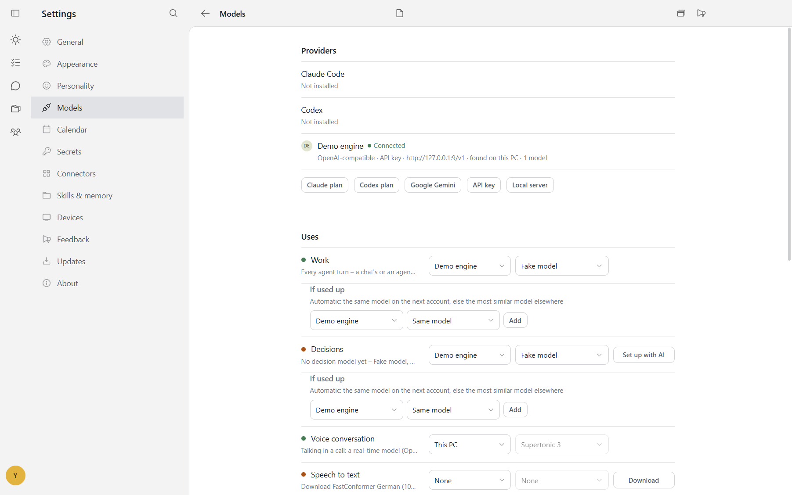
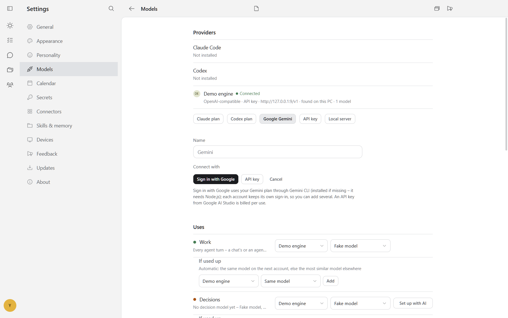

# Accounts, fallback and Gemini

Autark runs its agents on AI accounts you bring: a Claude plan (through Claude Code), a Codex plan, a Google Gemini plan or key, API keys,
or a local model server. Autark-Plus lets you have **several accounts per provider** and keeps working when one is used up.

*Demo profile: the only account is the built-in demo engine. Real accounts show their plan, quota and reset time.*

## Adding an account

**Settings → Models → Providers.** The buttons under the list add an account: *Claude plan*, *Codex plan*, *Google Gemini*, *API key*,
*Local server*. Plan accounts sign in through the provider's own command-line tool; Autark does not read the tokens. API keys go to the
secrets catalog (encrypted with the system keychain) and are shown to agents only as handles.

A second plan of the same provider (for example two Claude plans) is a normal second row. Rows can be renamed and show a logo and the quota
that the provider reports.

## Which account runs a turn

The account for a turn is chosen in this order:

1. The account you picked **for this chat** in the model menu.
2. The account set **as the agent's default** on its agent page.
3. **Automatic:** the provider's first healthy account.

The model menu names the account in use (for example "Opus 5.5 · work-2"). Effort is a slider with stops (Auto plus the model's efforts) in the
same menu.

## If an account is used up

Under **Settings → Models → Uses**, each use (*Work*, *Decisions* ...) has an **If used up** list: a sortable list of account + model. Leave it
empty for **Automatic**:

- The same model on the next healthy account; if there is none, the most similar model elsewhere.
- The router tries along a chain, each account at most once (at most 6), and skips accounts that are used up until their reset.
- The chat says it once, for example *"Switched to Work 2 - Work 1 is used up until 14:00."*

The setting is `routing.accountFallback` in `settings.json`: `switch` (default) switches by itself, `ask` stops the turn with a clear line and
the buttons "Use <other>" / "Automatic". The fallback order is stored in `routing.fallbacks`.

This was built because with two Claude plans, the first used up and the second half full, every turn used to fail with "Every account that
can run a suitable model is limited right now". 65 automated tests cover candidates, the router, the failover chain, validation and the UI order logic.

## Google Gemini

*Settings → Models → Google Gemini: name, then Sign in with Google or API key.*

- **Sign in with Google** uses your Gemini plan through the Gemini CLI. Autark installs the CLI for you through npm (`@google/gemini-cli`);
  without Node.js it tells you so. Each account gets its own folder (`GEMINI_CLI_HOME`, documented by Google) so several Google sign-ins work side by side.
  A login already present in `~/.gemini` is detected and kept.
- **API key** uses a key from Google AI Studio and is billed per use.
- Names default to Gemini, Gemini 2 and so on; *Add another account* is on every Gemini row.
- **Quota:** Gemini's quota messages give the wait; a daily quota counts as used up until the next Pacific midnight, per model where the quota is the
  model's. The fallback above then picks the next account or the nearest model. Settings shows these readings.
- Autark knows the Gemini Pro, Flash and Flash-Lite families and treats `models/gemini-x` (API) and `gemini-x` (CLI) as the same model.

40 automated tests cover the accounts, login files, login sync, ACP providers and the plan-setup UI.

## Known problem

In the live smoke test of 0.3.8 on Windows, *Sign in with Google* stayed on "Installing Gemini CLI - this takes about a minute ..." after the CLI had
already been installed. No sign-in link appeared, no browser opened, and the half-added account (state *needs login*) had no row in the list, so
it could not be removed in the UI. The likely cause is that the setup view is not refreshed after the install step resolves
(`apps/desktop/src/ui/onboarding/plan-setup.ts`, `apps/desktop/src/ui/settings/ModelSetup.tsx`). The API-key path was not checked, and no real
Gemini turn with a real Google login has been run. The window test `af024-gemini-window` also fails on a PC that already has the Gemini CLI.
Details: [test results](TEST_RESULTS.md).
