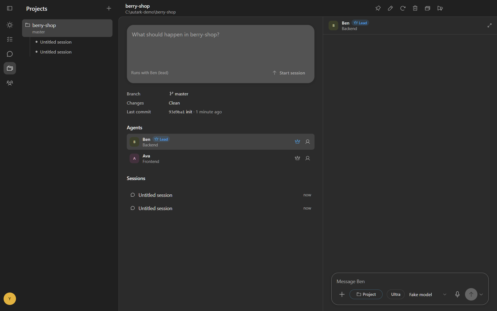

# Project isolation

*Demo profile: the project *berry-shop* with its two agents, Ben as project lead (crown), the sessions and a side chat.*

A **project** is a folder (see the Projects tab). Agents whose home is that folder belong to the project; one of them can be the **lead** (the
crown): it runs new sessions by default and coordinates the others. Isolation keeps a project's agents inside their project.

## The rule

It is a one-way street:

| Who | Reaches |
| --- | --- |
| An agent **in a project** (the lead included) | Only that project's agents, and you |
| An agent **outside every project** | Everyone, as before, including project agents |
| Project A | Never project B |
| **You** | Everyone; you are never limited |

A project agent may **answer** an outsider in the chat the outsider (or you) started, or in a thread on one of its messages. It does **not** open a new
chat, add a member, delegate, hand off or create a task outwards.

## Where it is enforced

The rule lives in one place, `apps/desktop/src/runtime/projects/isolation.ts`, and is checked at every gate:

- chat membership (every new member pair), `chat.send` and scheduled messages (every post)
- delegate and hand-off, task creation and assignment
- listing, updating and archiving agents
- an agent's own `wf` calls: parameters naming agents are refused, and `agents.list`, `org` and `activity` are filtered
  (`rpc/project-gate.ts`)

The agent's prompt gets a "My project" section that tells it the boundary (`projects/boundary-prompt.ts`).

## What it is and is not

- It limits **who an agent can talk to and hand work to**. It does not limit files, shell or network: for that, use the agent's
  [access mode](../README.md#settings-and-privacy) (read only, ask first, automatic in the project folder, full access).
- It is not a security boundary against a malicious model; it is a guard rail that keeps coordination tidy.

## Tested

22 automated tests (`test/unit/projects/project-isolation.test.ts`) cover the rules and the gates. It has not been exercised with live agents in a
long real session.
