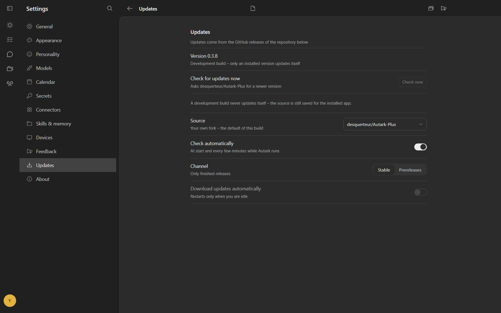

# Updates from this repository

Autark-Plus gets its updates from **`desquerteur/Autark-Plus`**, not from the original `teydra/OpenAutark`. That way an update of the original cannot
overwrite this fork's changes. Until 0.3.7 the source was the GitHub fork `desquerteur/OpenAutark`; 0.3.8 is the bridge release that moves it.

## In the app: Settings → Updates

| Row | What it does |
| --- | --- |
| **Version** | The installed version and the state (for example "Up to date"). A development build says so and never updates itself |
| **Check for updates now** | Asks the chosen source right away |
| **Source** | `desquerteur/Autark-Plus` (default), `teydra/OpenAutark` (the original: its updates replace this fork's changes), or any `owner/name` |
| **Check automatically** | On: at start and regularly; off: only by button |
| **Channel** | *Stable* (finished releases) or *Prereleases* (test versions such as `0.3.6-beta.1`) |
| **Download updates automatically** | Downloads in the background and restarts only when you are idle |

The choice is stored per PC in `update-source.json` in the data folder. When an update exists, a notice shows the version and the release notes with
**Install now** (drafts and agent work are saved, Autark restarts) and **Later**. If the source has no release yet, the app says so calmly; that is not an error.
An offered version must be newer than the installed one.

How an install runs on each system is in the README's [Updates](../README.md#updates) section. A headless Linux server does not self-update; it uses
the installer's `--update` ([Linux headless](LINUX_HEADLESS.md#updating)).

## Publishing a release (maintainers)

1. **Raise the version** in `apps/desktop/package.json` (`npm version 0.3.10 --no-git-tag-version`) and commit. It must be higher than the installed one.
2. **Optional:** write the notes in `docs/releases/v0.3.10.md`; the app shows them in the update notice. Without the file GitHub lists the commits.
3. **Push the tag** `v0.3.10`. The workflow `.github/workflows/build-desktop.yml` builds Windows, Mac and Linux and publishes a release with the installers,
   the `latest*.yml` files that tell the app which version exists (with SHA-512 that the app checks), `SHA256SUMS.txt` and `release.json`.

The release stays a draft until all three platforms are built. A tag with a hyphen (`v0.3.10-beta.1`) is published as a **prerelease**, which only apps on
the *Prereleases* channel receive. A failed platform can be rebuilt from *Actions → Build desktop packages → Run workflow*.

Longer maintainer notes (German): [UPDATES_FORK.md](UPDATES_FORK.md).

## Coming from the original app

The original currently makes switching hard; read this before installing over it:

- **Its uninstaller can fail** with code 2 even when Autark is not running, and then this installer stops too. Workaround: quit Autark, rename
  `%LOCALAPPDATA%\Programs\Autark` (for example to `Autark.old`), export and remove its entry under
  `HKCU\Software\Microsoft\Windows\CurrentVersion\Uninstall`, then run this installer.
- **Its newer versions change your data so this fork cannot open it.** The original updates itself from the original and ships database changes that are not
  in its public source (its 0.3.5 uses data schema 97; the public source and this fork stop at 91). This fork then shows a repair screen
  ("Your data is from a newer version"). **Restore** goes back to the copy from before that update; everything done since is not in it (it is set aside in
  `%APPDATA%\Autark\before-repair-...`). To keep that data, stay on the original's app.
- A version built **before** the source change (for example a self-built 0.3.4) still looks at `teydra/OpenAutark` until you install a version with the change.

## Unsigned installers

The installers are not signed with a paid publisher certificate yet. Windows SmartScreen shows "Windows protected your PC" (More info → Run anyway); on a
Mac use right-click → Open once. Compare the download with `SHA256SUMS.txt`.
